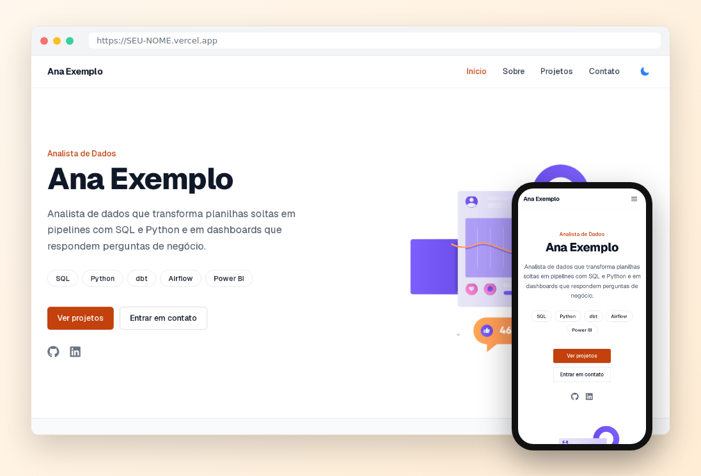
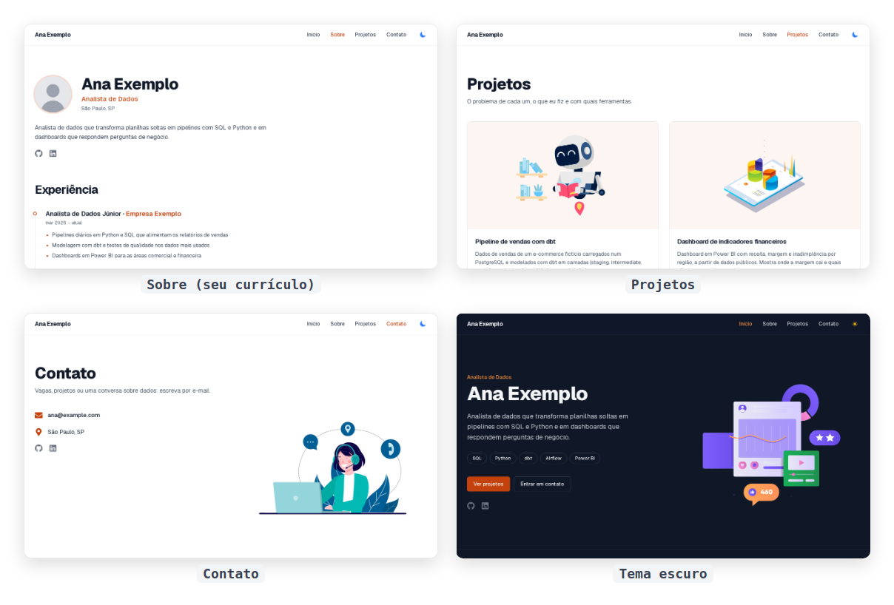
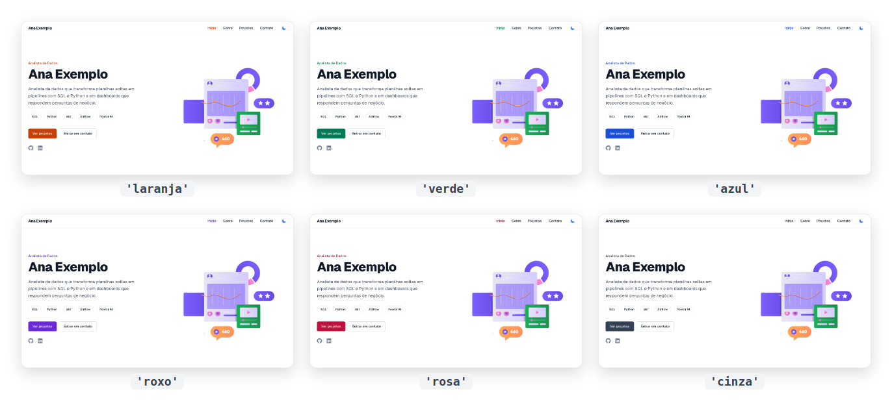

# Data Portfolio Template

Um portfólio pronto para quem trabalha (ou quer trabalhar) com dados: analistas, engenheiros e
cientistas de dados. **Você não precisa saber programar.** O site vai ao ar com um clique e você
troca os textos e as fotos pelo navegador.



Veja o site funcionando, com as animações e o tema escuro (26 segundos):

https://github.com/user-attachments/assets/74839262-7107-444c-9e00-9b0d4a717b29

## O que vem pronto

- **Quatro páginas:** início, sobre (seu currículo), projetos e contato.
- **Tema claro e escuro**, e funciona bem no celular.
- **Seis cores** para escolher com uma palavra.
- **Aparece bem no Google e no LinkedIn:** quando você compartilha o link, aparece uma prévia com
  o seu nome e o seu cargo.
- **Grátis:** o GitHub guarda os arquivos e a Vercel deixa o site no ar, os dois sem custo para
  um portfólio pessoal.



## Comece aqui

São cerca de **40 minutos** do zero ao site com os seus dados. Você vai precisar de:

- uma conta no [GitHub](https://github.com/signup) (grátis);
- seu resumo profissional, experiências e projetos (pode ser o texto do seu LinkedIn);
- uma foto sua e, se tiver, o currículo em PDF e prints dos projetos.

[](https://vercel.com/new/clone?repository-url=https%3A%2F%2Fgithub.com%2FWelbert-Soares%2Fdata-portfolio-template)

Depois de clicar no botão, siga o guia na ordem:

| Passo | O que você faz | Tempo |
|---|---|---|
| [1. Coloque o site no ar](docs/guia/1-publicar.md) | Cria a sua cópia e publica o site de exemplo | 10 min |
| [2. Coloque os seus dados](docs/guia/2-seus-dados.md) | Troca nome, resumo, experiências e projetos | 15 min |
| [3. Foto, currículo e prints](docs/guia/3-fotos-e-arquivos.md) | Envia suas imagens e o PDF | 10 min |
| [4. Projetos que chamam atenção](docs/guia/4-bons-projetos.md) | Aprende a descrever projetos com problema e resultado | 5 min |
| [5. Deu erro?](docs/guia/5-deu-erro.md) | Acha e corrige um erro (só se precisar) | — |
| [6. Extras](docs/guia/6-extras.md) | Cor, formulário de contato, Google Analytics, domínio próprio | opcional |

## Palavras que você vai ver

| Palavra | O que é |
|---|---|
| **Repositório** | A pasta no GitHub com todos os arquivos do seu site. |
| **Commit** | Salvar uma alteração no GitHub. Cada commit fica guardado, então dá para voltar atrás. |
| **Deploy** | Publicar o site. A Vercel faz um deploy sozinha a cada commit. |
| **Vercel** | O serviço que deixa o seu site no ar, em `https://SEU-NOME.vercel.app`. |

## Escolha a cor

Uma palavra no `personal.ts` (`color: 'laranja'`) muda a cor do site inteiro. Como fazer:
[guia de extras](docs/guia/6-extras.md#trocar-a-cor-do-site).



## Perguntas frequentes

**Quanto custa?** Nada. O plano grátis da Vercel (Hobby) é para projetos pessoais, e um
portfólio se encaixa. Só um domínio próprio, que é opcional, é pago.

**Meu e-mail fica público?** Sim, ele aparece na página de contato, como num currículo. Use um
e-mail profissional.

**Errei e o site quebrou?** Não quebrou: a versão anterior continua no ar até você corrigir.
Veja [Deu erro?](docs/guia/5-deu-erro.md).

**Posso mudar o texto dos títulos e botões?** Pode, mas eles ficam no código das páginas
(`src/app/`), não nos arquivos de conteúdo. Mexa com calma e faça um commit por vez.

**O template vai receber melhorias?** O seu site é uma cópia independente: ele não muda sozinho.
Isso também quer dizer que nada que mude aqui quebra o seu site.

**Preciso apagar a pasta `docs/`?** Não. Ela é só este guia e não aparece no site.

## Para quem programa

Next.js 15 (App Router), TypeScript, Tailwind CSS 4, Framer Motion e lottie-web. Todas as páginas
são estáticas.

```bash
git clone https://github.com/SEU-USUARIO/SEU-REPOSITORIO.git
cd SEU-REPOSITORIO
npm install
npm run dev        # http://localhost:3000, atualiza ao salvar
```

| Comando | O que faz |
|---|---|
| `npm run build` | Versão de produção (também checa os tipos) |
| `npm run start` | Roda o build |
| `npm run lint` | ESLint |
| `npm run typecheck` | `tsc --noEmit` |

- **Conteúdo:** `src/contents/`. **Cores:** `src/lib/theme.ts` (para uma cor nova, adicione o
  nome em `ColorName`, em `src/types/index.ts`, e os tons em `theme.ts`).
- **Animação de scroll:** `src/app/components/Reveal.tsx`, a única do site; respeita
  `prefers-reduced-motion`.
- **Ilustrações:** `src/app/components/Lottie.tsx` carrega o player só quando a página tem
  animação e só toca enquanto ela está na tela.
- **Endereço do site:** `src/lib/site.ts` usa o `siteUrl` do `personal.ts`, ou o
  `VERCEL_PROJECT_PRODUCTION_URL` no build da Vercel, ou `localhost`.
- **Variáveis opcionais:** veja `.env.example` (EmailJS e Google Analytics).
- **CI:** `.github/workflows/ci.yml` roda lint e build em cada push e pull request.

## Licença

O código está sob a [MIT](LICENSE): use, modifique e publique como quiser, inclusive
comercialmente. Os dados de exemplo são fictícios.

As animações em `public/animations/` são do LottieFiles, criadas por Abdul Latif, e seguem a
Lottie Simple License, que também permite uso comercial. Créditos e termos em
[`public/animations/LICENSE.md`](public/animations/LICENSE.md).

Este repositório é só um ponto de partida e não aceita issues nem pull requests.
