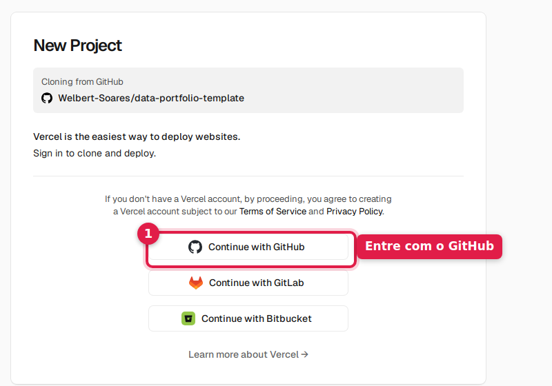
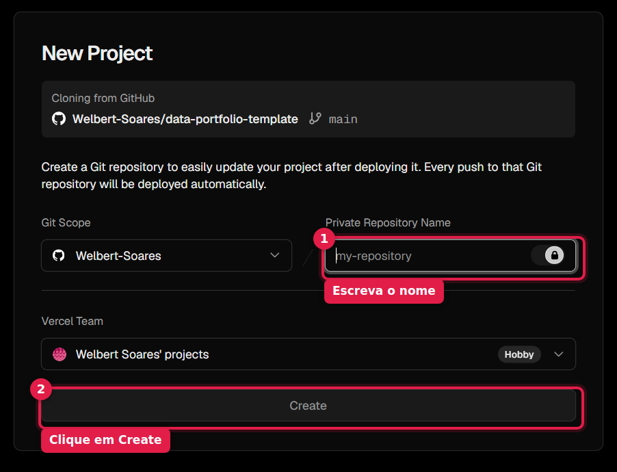
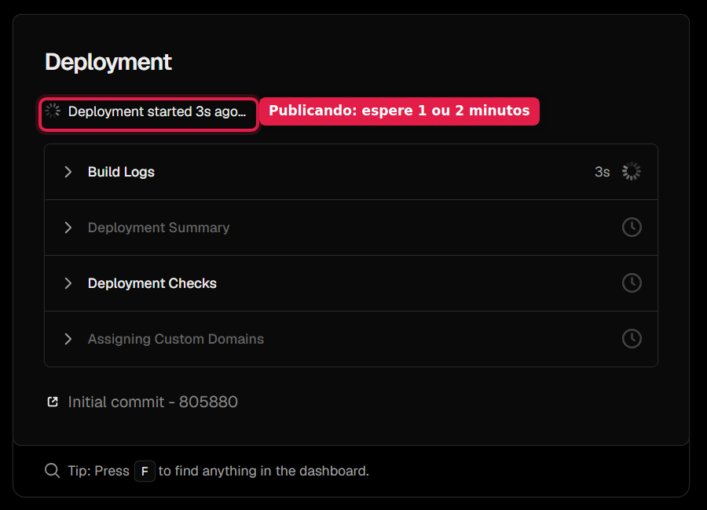
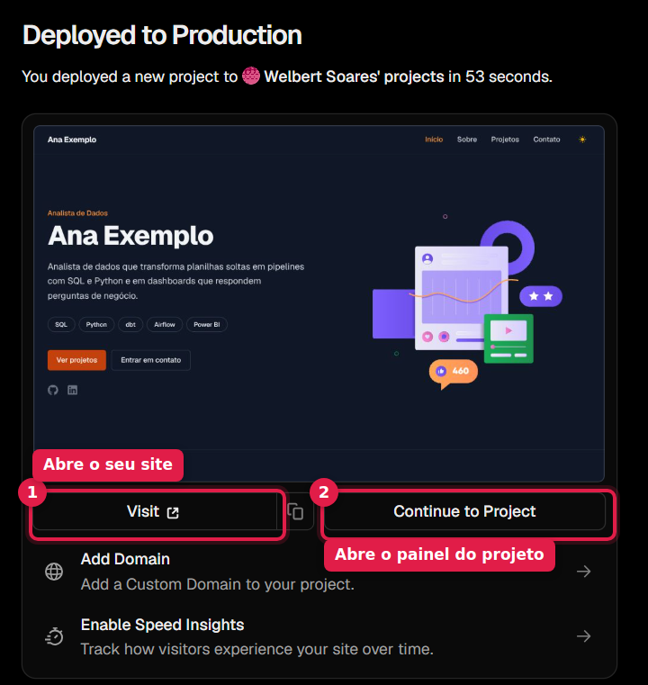
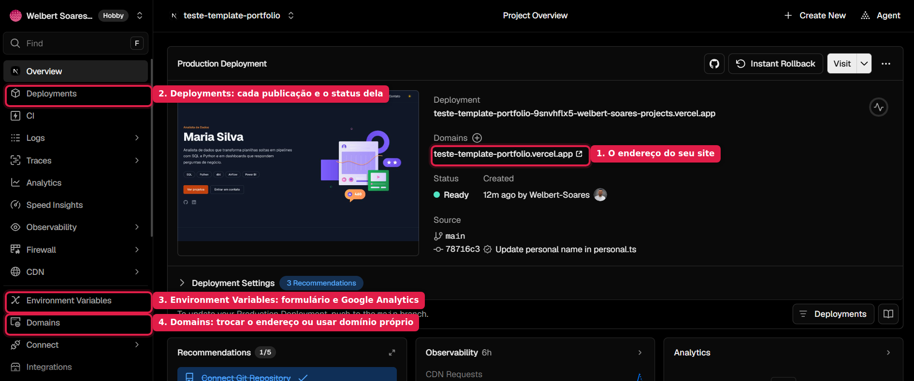

# 1. Coloque o site no ar

⏱️ Cerca de 10 minutos · [← Voltar ao início](../../README.md)

Neste passo você cria a sua cópia do template e publica o site na internet. Ainda com os dados de
exemplo: os seus entram no [passo 2](2-seus-dados.md).

## Você vai precisar

- Uma conta no [GitHub](https://github.com/signup). É grátis. O GitHub guarda os arquivos do seu
  site.
- Mais nada. A conta na Vercel, que deixa o site no ar, é criada com o próprio GitHub.

## 1.1 Clique no botão de deploy

Volte ao [README](../../README.md) e clique no botão preto **Deploy**. Ele abre a Vercel.

Na primeira vez, a Vercel pede para você entrar. Clique em **Continue with GitHub** e autorize:

## 1.2 Dê um nome ao seu repositório

Depois de entrar, a Vercel pergunta o nome do **repositório**, que é a pasta no GitHub onde os
arquivos do site vão ficar.

1. Em **Private Repository Name**, escreva um nome com o seu nome, como `maria-silva-portfolio`.
   Use só letras minúsculas, números e hífens.
2. Clique em **Create**. O botão só fica clicável depois que você escreve o nome.

Não mexa no resto da tela. **Git Scope** já vem com a sua conta do GitHub e **Vercel Team** com
o seu plano grátis (*Hobby*).

> **Privado ou público?** O cadeado ao lado do nome deixa o **repositório** privado: só você vê
> os arquivos no GitHub. O **site** continua público, qualquer pessoa abre o endereço. Pode deixar
> como está. Quer que recrutadores vejam o código do seu portfólio? Clique no cadeado para
> deixar o repositório público.

O endereço do site sai desse nome (`https://maria-silva-portfolio.vercel.app`). Se alguém já
usa esse nome na Vercel, ela acrescenta letras e números no fim. Dá para trocar depois, no
[passo 6](6-extras.md#trocar-o-endereço-vercelapp).

> **Pediu um código de 6 dígitos ("Verify Your Identity")?** Só aparece se você já ativou a
> verificação em duas etapas na Vercel. Abra o app autenticador (Google Authenticator, Authy…),
> digite o código de "Vercel" e clique em **Verify Code**. Sem o app à mão, use **Use a recovery
> code instead** com um dos códigos de recuperação que você guardou ao ativar a verificação.

## 1.3 Espere o primeiro deploy

A Vercel copia o template para o seu GitHub e prepara o site. Enquanto isso, a tela mostra
**Deployment started** com um ícone girando. Não precisa clicar em nada:

Em um ou dois minutos aparece **Deployed to Production**, com a miniatura do site:

1. **Visit** abre o seu site. Ele vai mostrar a "Ana Exemplo", e é isso mesmo.
2. **Continue to Project** abre o **painel do projeto** na Vercel.

O painel é a sua central na Vercel. Para voltar a ele depois, entre em
[vercel.com](https://vercel.com) e clique no nome do projeto. Tudo o que você vai usar fica ali:

1. **O endereço do seu site**, que você pode copiar e compartilhar.
2. **Deployments**: a lista de publicações, uma por commit. Serve para ver se deu erro
   ([passo 5](5-deu-erro.md)).
3. **Environment Variables**: para ligar o formulário de contato e o Google Analytics
   ([passo 6](6-extras.md)).
4. **Domains**: para trocar o endereço ou usar um domínio próprio ([passo 6](6-extras.md)).

## ✅ Deu certo se…

- Você abre o endereço `https://SEU-NOME.vercel.app` e vê o site de exemplo.
- No GitHub, em **Your repositories**, aparece o repositório que você acabou de criar.

Guarde os dois endereços: o do **site** e o do **repositório no GitHub**
(`github.com/SEU-USUARIO/SEU-REPOSITORIO`). Você vai usar o do repositório em todos os passos
seguintes.

**Próximo passo →** [2. Coloque os seus dados](2-seus-dados.md)
