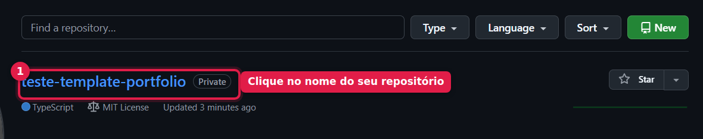
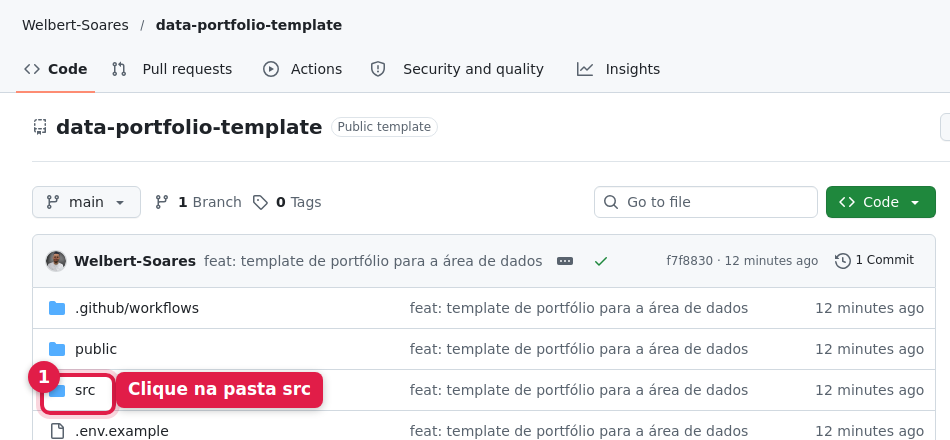
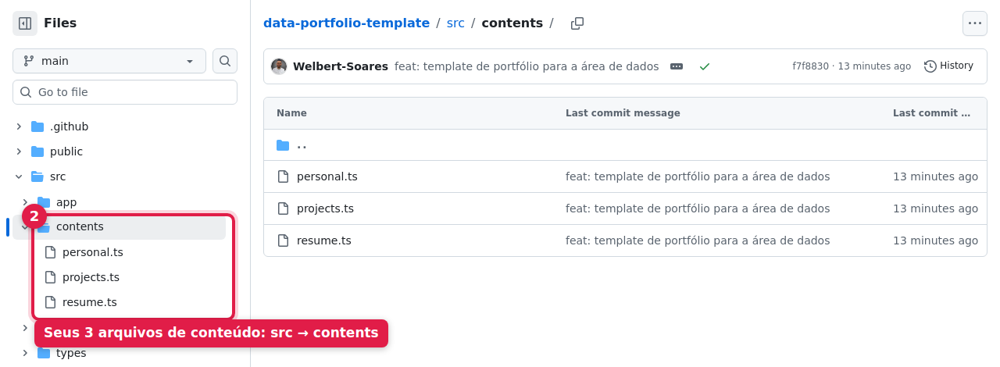
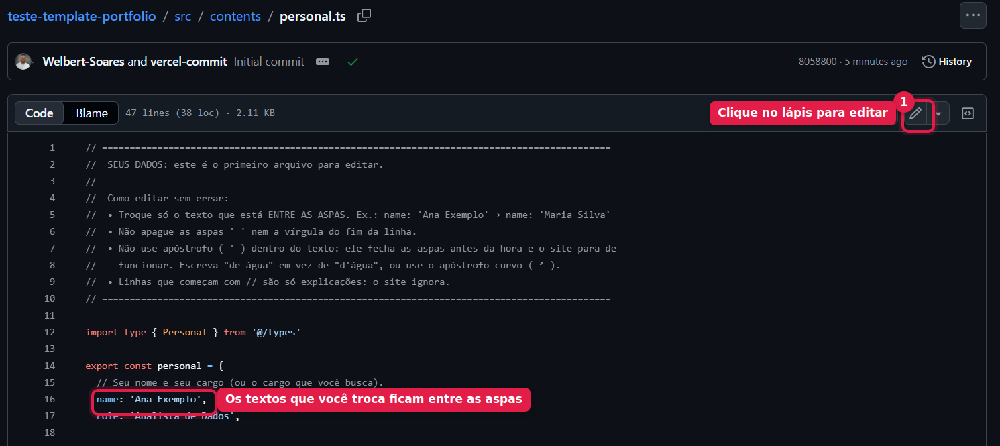
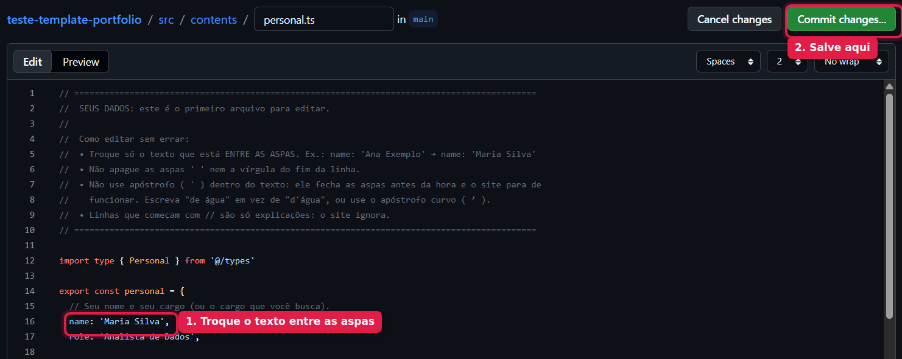
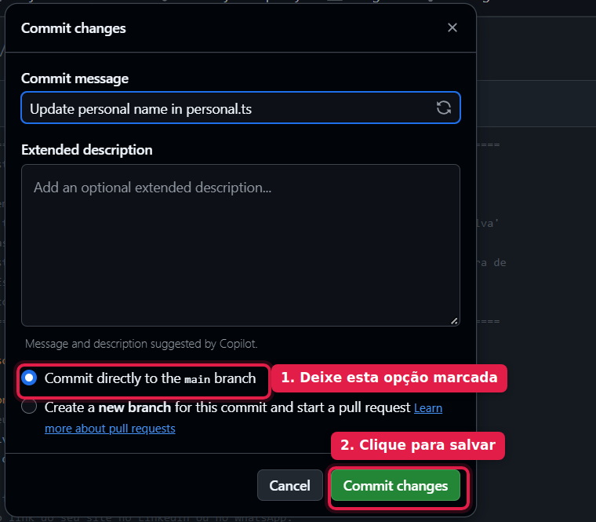

# 2. Coloque os seus dados

⏱️ Cerca de 15 minutos · [← Voltar ao início](../../README.md)

Todo o texto do site fica em três arquivos. Você edita pelo próprio GitHub, no navegador, sem
instalar nada.

| Arquivo | O que tem | Aparece em |
|---|---|---|
| `personal.ts` | Nome, cargo, resumo, cor do site, e-mail, cidade, GitHub e LinkedIn | Todas as páginas |
| `resume.ts` | Experiências, ferramentas, formação, certificações e idiomas | Sobre |
| `projects.ts` | Seus projetos | Projetos e página inicial |

## 2.1 Encontre os arquivos

Entre em [github.com](https://github.com), clique na sua foto (canto superior direito) e em
**Your repositories**. O repositório que a Vercel criou aparece com o nome que você escolheu.
O selo **Private** só quer dizer que os arquivos são privados: o site continua público.



Clique no nome do repositório e, dentro dele, na pasta **src**:



Depois, clique em **contents**. Os três arquivos estão lá:



## 2.2 Abra o arquivo para editar

Clique em **personal.ts** e depois no **lápis** (✏️, *Edit this file*), no canto direito:



## 2.3 Troque os textos

O arquivo abre num editor. Cada arquivo começa com instruções em cinza (as linhas com `//`). A
regra mais importante é: **troque só o que está entre as aspas**.



```ts
// Antes
name: 'Ana Exemplo',

// Depois
name: 'Maria Silva',
```

Cuidados que evitam quase todos os erros:

- Mantenha as aspas `'` e a vírgula no fim da linha.
- Não use apóstrofo dentro do texto: `d'água` quebra o site. Escreva `de água`.
- Quer esconder o GitHub ou o LinkedIn? Deixe as aspas vazias: `github: '',`.

## 2.4 Salve (commit)

No GitHub, salvar se chama **commit**. Clique em **Commit changes…** no canto superior direito.
Abre uma janela:



1. Confira se está marcada a opção **Commit directly to the `main` branch**. Ela já vem
   marcada; só não troque para *Create a new branch*, porque aí a alteração não chega ao site.
2. Clique em **Commit changes**.

A mensagem do commit (*Commit message*) já vem escrita e pode ficar como está.

## 2.5 Espere a Vercel publicar

A cada commit, a Vercel publica o site de novo, sozinha, em cerca de um minuto. Atualize a página
do seu site e veja a mudança.

Repita os passos 2.2 a 2.4 para o `resume.ts` e o `projects.ts`. Pode fazer um arquivo de cada
vez, com um commit cada.

## Adicionar ou remover itens

No `resume.ts` e no `projects.ts`, cada experiência e cada projeto é um **bloco** que começa com
`{` e termina com `},`:

```ts
  {
    company: 'Empresa Exemplo',
    title: 'Analista de Dados Júnior',
    start: '2025-03',
    end: null,
    bullets: [
      'Pipelines diários em Python e SQL',
      'Dashboards em Power BI',
    ],
  },
```

- **Adicionar:** copie um bloco inteiro, do `{` até o `},`, cole logo abaixo e troque os textos.
- **Remover:** apague o bloco inteiro, do `{` até o `},`.
- **Datas:** no formato `'ANO-MÊS'`, com dois dígitos no mês (março de 2025 = `'2025-03'`). No
  trabalho atual, escreva `end: null`, sem aspas.

## ✅ Deu certo se…

O seu site mostra o seu nome, o seu cargo e o seu resumo. Se, um minuto depois do commit, nada
mudou, veja o [passo 5](5-deu-erro.md).

**Próximo passo →** [3. Foto, currículo e prints](3-fotos-e-arquivos.md)
