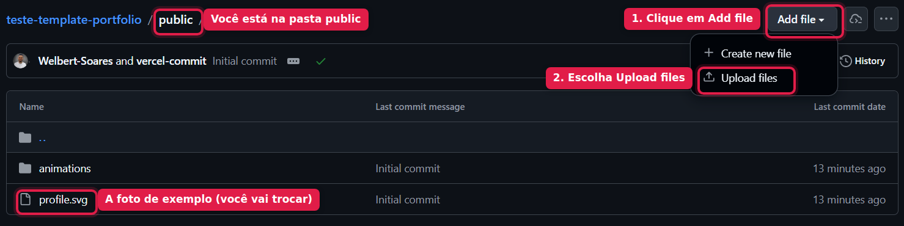
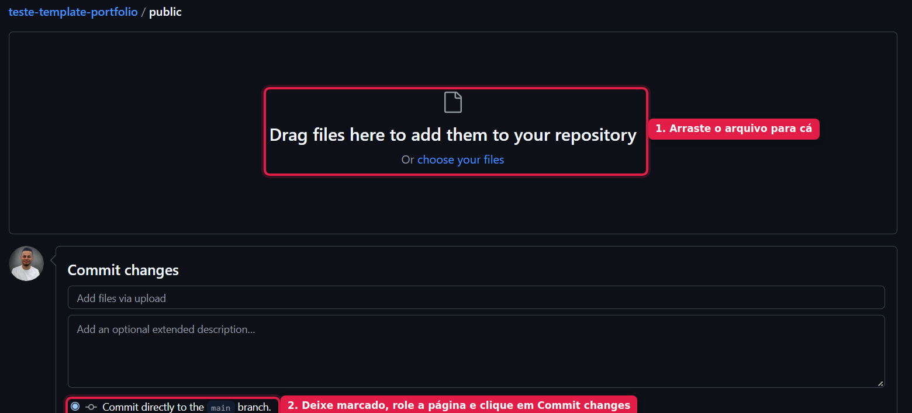
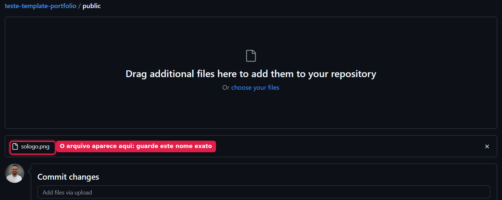

# 3. Foto, currículo e prints

⏱️ Cerca de 10 minutos · [← Voltar ao início](../../README.md)

Imagens e PDFs ficam na pasta `public/`. São duas etapas: **enviar o arquivo** e **escrever o
nome dele** no arquivo de conteúdo.

## Antes de enviar: prepare os arquivos

| O quê | Formato | Tamanho bom | Nome sugerido |
|---|---|---|---|
| Sua foto | `.jpg` ou `.png`, quadrada | 400×400 ou maior | `minha-foto.jpg` |
| Currículo | `.pdf` | até 2 MB | `curriculo.pdf` |
| Print de um projeto | `.png` ou `.jpg`, deitado (16:9) | 1600×900 | `dashboard-vendas.png` |

Use **nomes sem espaços, acentos ou letras maiúsculas**: `minha-foto.jpg` funciona,
`Minha Foto Nova.JPG` dá trabalho.

Dica para a foto: fundo neutro, rosto bem iluminado e enquadramento do peito para cima. Para
recortar no formato quadrado, qualquer editor do celular serve.

## 3.1 Envie o arquivo

1. No seu repositório, entre na pasta **public** (os prints dos projetos vão em
   **public → projects**).
2. Clique em **Add file → Upload files**:

   

3. Arraste o arquivo para o quadro (ou clique em *choose your files* e escolha o arquivo):

   

4. O nome do arquivo aparece abaixo do quadro. **Anote esse nome exatamente como está**: é ele
   que você vai escrever no passo 3.2.

   

5. Confira se **Commit directly to the `main` branch** está marcado, role a página até o fim e
   clique em **Commit changes**.

## 3.2 Escreva o nome do arquivo

Abra o arquivo de conteúdo (como no [passo 2](2-seus-dados.md)) e escreva o nome do arquivo
**com uma barra no começo**:

| O quê | Arquivo | Escreva |
|---|---|---|
| Foto (em `public/`) | `personal.ts` | `photo: '/minha-foto.jpg',` |
| Currículo (em `public/`) | `resume.ts` | `pdf: '/curriculo.pdf',` |
| Print (em `public/projects/`) | `projects.ts` | `image: '/projects/dashboard-vendas.png',` |

A foto aparece na página **Sobre**. O currículo vira o botão **Baixar currículo** na mesma página.

## Ainda não tem print dos projetos?

Sem problema: as capas de exemplo são animações. Use `'/animations/projeto-1.json'`,
`'/animations/projeto-2.json'` ou `'/animations/projeto-3.json'` até ter os seus prints.

Para tirar um bom print de um dashboard ou notebook:

- Mostre o resultado (gráficos e números), não a tela de login ou o código.
- Deixe o navegador em tela cheia e esconda barras e abas.
- Esconda dados sensíveis: nomes de clientes, valores reais da empresa.

## ✅ Deu certo se…

A página **Sobre** mostra a sua foto e as capas dos projetos mostram os seus prints. Se a imagem
não aparecer, confira se o nome escrito é **idêntico** ao do arquivo, com a mesma extensão
(`.jpg` não é `.jpeg`) e as mesmas letras.

**Próximo passo →** [4. Projetos que chamam atenção](4-bons-projetos.md)
