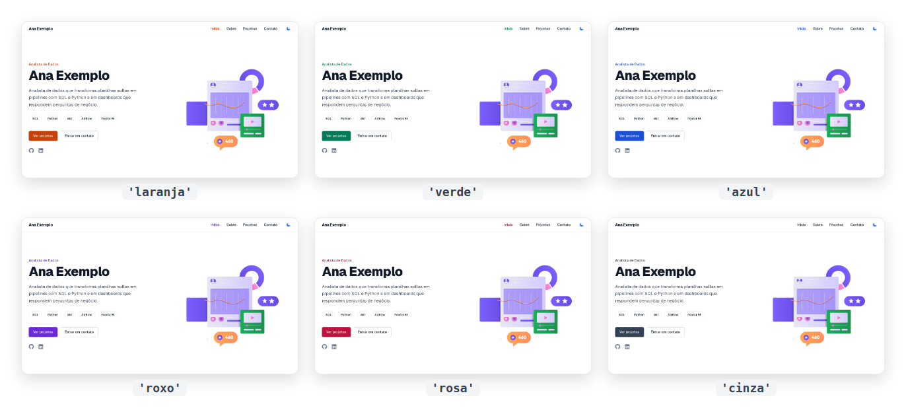
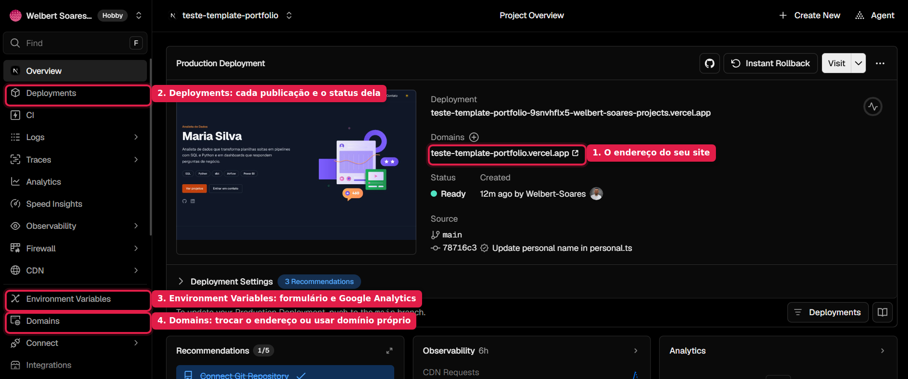

# 6. Extras

[← Voltar ao início](../../README.md)

Nada aqui é obrigatório. O site funciona completo sem nenhum destes extras.

- [Trocar a cor do site](#trocar-a-cor-do-site)
- [Formulário de contato](#formulário-de-contato)
- [Google Analytics](#google-analytics)
- [Trocar o endereço .vercel.app](#trocar-o-endereço-vercelapp)
- [Domínio próprio](#domínio-próprio)
- [Trocar as ilustrações animadas](#trocar-as-ilustrações-animadas)

## Trocar a cor do site

No `personal.ts`, troque o valor de `color` por uma destas seis cores:



```ts
color: 'azul',
```

Botões, links, detalhes e a imagem que aparece quando alguém compartilha o seu link mudam juntos.
O contraste de todas as cores já foi testado no tema claro e no escuro. As ilustrações animadas
têm cores próprias e não mudam.

## Como adicionar uma variável na Vercel

O formulário e o Google Analytics são ligados por **variáveis**, que são configurações guardadas
na Vercel, fora do código. Para adicionar uma:

> **Atenção: é na Vercel, não no GitHub.** O GitHub também tem uma aba **Settings**, com um item
> **Environments** parecido, mas as variáveis do site não ficam lá.

1. Entre em [vercel.com](https://vercel.com), clique no nome do seu projeto e, no menu da
   esquerda, em **Environment Variables**:

   

2. Em **Key**, escreva o nome da variável, e em **Value**, o valor. Clique em **Save**.
3. As variáveis só valem a partir do próximo deploy. No menu da esquerda, clique em
   **Deployments**, depois nos três pontinhos (**⋯**) da primeira linha e em **Redeploy**.

## Formulário de contato

Sem configurar, a página de contato mostra o seu e-mail, que já funciona. Com o
[EmailJS](https://www.emailjs.com/) (grátis até 200 mensagens por mês), ela ganha um formulário
que chega na sua caixa de entrada.

1. Crie uma conta no EmailJS.
2. Em **Email Services → Add New Service**, escolha o seu e-mail (Gmail, Outlook…) e conecte.
   Copie o **Service ID** (algo como `service_abc123`).
3. Em **Email Templates → Create New Template**, escreva o e-mail que você quer receber usando
   estas três variáveis:

   ```
   Nova mensagem do portfólio

   Nome: {{name}}
   E-mail: {{email}}

   {{message}}
   ```

   Salve e copie o **Template ID** (algo como `template_xyz789`).
4. Em **Account → General**, copie a **Public Key**.
5. Na Vercel, crie as três variáveis e faça o **Redeploy**:

   | Key | Value |
   |---|---|
   | `NEXT_PUBLIC_EMAILJS_SERVICE_ID` | o Service ID |
   | `NEXT_PUBLIC_EMAILJS_TEMPLATE_ID` | o Template ID |
   | `NEXT_PUBLIC_EMAILJS_PUBLIC_KEY` | a Public Key |

Teste mandando uma mensagem para você mesmo pela página de contato.

## Google Analytics

Mostra quantas pessoas visitam o seu site e de onde elas vêm (LinkedIn, Google…).

1. Em [analytics.google.com](https://analytics.google.com/), crie uma conta e uma
   **propriedade** com o nome do seu site.
2. Escolha **Web**, informe o endereço do site e copie o **ID da métrica**
   (`G-` seguido de letras e números).
3. Na Vercel, crie a variável `NEXT_PUBLIC_GA_ID` com esse ID. Marque só o ambiente
   **Production**, para as suas visitas de teste não contarem. Faça o **Redeploy**.

Os primeiros dados aparecem no Google Analytics em até 24 horas.

## Trocar o endereço .vercel.app

Quer `maria-silva.vercel.app` em vez do endereço que a Vercel escolheu? No seu projeto **na
Vercel** (não no GitHub), clique em **Domains** no menu da esquerda e edite o endereço
`.vercel.app` que aparece na lista. Se o novo nome estiver livre, a troca é imediata.

## Domínio próprio

Comprou um domínio, como `SEU-DOMINIO.com.br` (no Registro.br, por exemplo)?

1. No seu projeto na Vercel, clique em **Domains** no menu da esquerda e adicione o domínio.
2. A Vercel mostra os registros de DNS que você precisa criar onde comprou o domínio. Siga as
   instruções da tela; a confirmação pode levar algumas horas.
3. No `personal.ts`, escreva o domínio em `siteUrl`: `siteUrl: 'https://www.SEU-DOMINIO.com.br',`.

## Trocar as ilustrações animadas

As ilustrações da página inicial, do contato e da página 404 são animações Lottie, em
`public/animations/`.

1. Escolha uma animação em [lottiefiles.com/free-animations](https://lottiefiles.com/free-animations).
2. Baixe no formato **Lottie JSON**.
3. Envie para `public/animations/` (como no [passo 3](3-fotos-e-arquivos.md)) com um nome
   simples, como `minha-animacao.json`.
4. Troque o nome no arquivo que usa a animação:

   | Ilustração | Arquivo | Procure por |
   |---|---|---|
   | Página inicial | `src/app/page.tsx` | `/animations/home-dados.json` |
   | Contato | `src/app/contact/page.tsx` | `/animations/contato.json` |
   | Página 404 | `src/app/not-found.tsx` | `/animations/404.json` |

Animações do LottieFiles são gratuitas, inclusive para uso comercial (Lottie Simple License).
Anote o autor em `public/animations/LICENSE.md` se quiser dar o crédito.

[← Voltar ao início](../../README.md)
